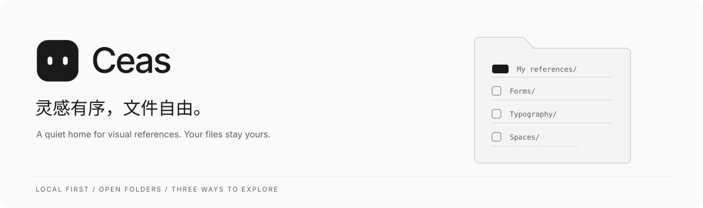
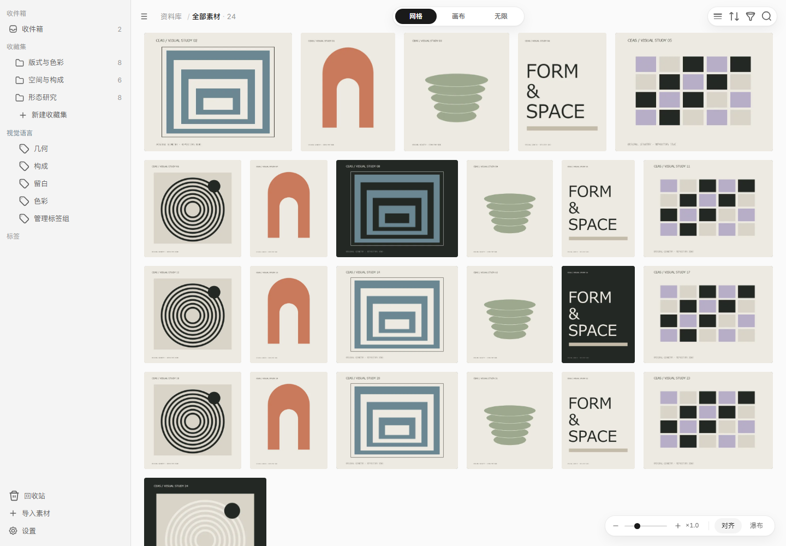
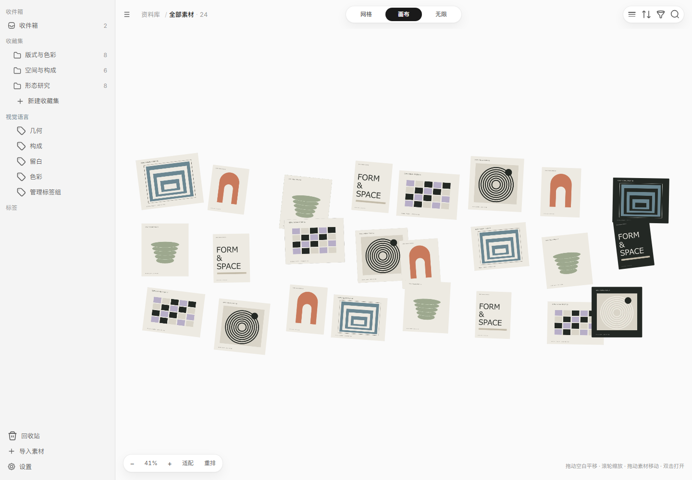
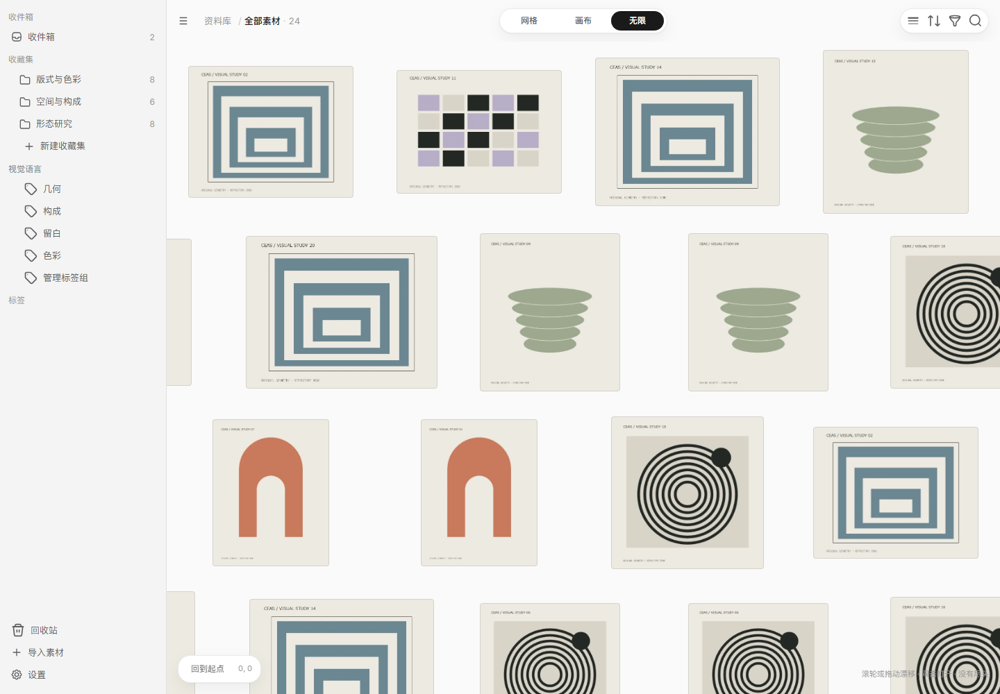

<p align="center">
  
</p>

<p align="center">
  
  
  
  
</p>

<p align="center">
  <strong>一个本地优先的视觉灵感库。</strong><br />
  收集、浏览、整理参考素材，让灵感留下来，也让文件始终属于你。
</p>

<p align="center">
  <a href="#预览">界面预览</a> ·
  <a href="#文件就是文件">目录模型</a> ·
  <a href="#开始开发">开始开发</a> ·
  <a href="docs/10-下一步计划.md">开发计划</a> ·
  <a href="docs/05-项目规范.md">项目规范</a>
</p>

## 预览

<p align="center">
  
</p>

<p align="center"><sub>真实开发界面，使用专为仓库展示绘制的原创几何样张。个人资料库与参考图片未包含在仓库中。</sub></p>

| 画布 · 把关系摆出来 | 无限 · 换一种方式看灵感 |
| :---: | :---: |
|  |  |
| 自由摆放、平移缩放，保留素材位置 | 在连续平面中漫游，保留浏览位置 |

## 文件就是文件

资料库对应一个普通文件夹，收藏集对应其中的同名子文件夹。原件保留名字和扩展名，
可以继续用资源管理器或其他软件查看、编辑和整理。

```text
我的参考库/
├── 待整理.png                    ← 收件箱
├── 形态研究/                     ← 收藏集
│   ├── 陶器.jpg
│   └── 建筑/拱门.png             ← 子收藏集
├── 版式与色彩/海报.png
└── .ceas/                       ← 元数据、索引与回收区
```

文件位置、内容指纹和素材身份分开保存。修改目录名字时，整理信息仍与原素材关联。
标签、描述、来源、评分等人工信息保存在库内 SQLite 数据库中；请随原件一起保留 `.ceas`。

## 现在可以做什么

| 浏览 | 采集 | 整理 |
| --- | --- | --- |
| 对齐网格与瀑布流 | 拖入文件和完整目录 | 新建、打开与切换多个资料库 |
| 自由画布与无限视图 | 文件夹层级、空目录保留 | 库改名、位置迁移与重新定位 |
| 三档密度、明暗主题 | 资源管理器文件粘贴 | 收藏集改名、移动与回收恢复 |
| 搜索、排序和组合筛选 | Pixcall 本地目录与元数据导入 | 标签组、描述、来源与评分 |
| 九色索引与相似颜色筛选 | 收件箱过片与会话撤销 | 文件变化检查、冲突与失败处理 |

当前是 **Alpha / 工程验证阶段**，尚未发布正式安装包。资料库格式仍可能调整，建议先用测试资料。

**接下来**：托盘与单实例、拖出与导出、备份与修复；之后再推进 Linux 自托管同步、网页浏览和手机离线包。
服务端、PWA 和 ZIP 离线包目前只有方案。浏览器开发预览不等同于服务端网页。

## 开始开发

当前主要验证 Windows 桌面端。准备 Node.js 24+、pnpm 10、Rust MSVC 工具链、
Visual Studio C++ Build Tools、Windows SDK 和 WebView2。

将项目克隆到 **非 C 盘**。环境脚本会按项目位置解析缓存目录，不需要修改为作者的电脑路径。

```powershell
git clone https://github.com/hoangmaituan882-hue/ceas.git
cd ceas

# 每个新终端先加载环境，让缓存和临时文件留在项目盘
. .\scripts\env.ps1
node scripts/check-paths.mjs

pnpm install --frozen-lockfile
pnpm desktop
```

环境脚本会将 `RUSTUP_HOME` 和 `CARGO_HOME` 指向项目 `.cache`。
首次使用需要在加载环境后准备该位置的工具链，例如运行 `rustup toolchain install stable`。
系统级的 MSVC、Windows SDK 和 WebView2 不随项目安装。

只看浏览器开发预览，可以运行 `pnpm dev`。默认没有演示素材；选择文件导入，
或在本机显式设置 `CEAS_FIXTURES` 指向自己的预览目录。此目录不会进入生产构建。

### 常用检查

```powershell
pnpm check                         # 路径守卫 + TypeScript
pnpm check:query-design            # 设计约束
pnpm test:query                    # 查询规则
pnpm test:collections              # 收藏集身份与目录关系
pnpm test:files                    # 文件核对与失败分类
pnpm test:library                  # 路径、颜色与元数据
pnpm test:acquisition              # 拖入落点规则
pnpm test:storage                  # Rust 持久化与文件操作
pnpm build                        # 前端生产构建
pnpm desktop:build                # 桌面打包
```

浏览器联调和原生 UI 验收需要独立测试服务、测试库与调试宿主，不能直接运行在日常资料库上。
具体准备方式见 [Windows 客户端计划](docs/06-Windows客户端计划.md) 与各阶段 ADR。

## 项目结构

```text
apps/desktop/       React 工作区与 Tauri 能力编排
packages/core/      纯 TypeScript 模型、查询与协调规则
packages/views/     网格布局、画布与无限视图
packages/ui/        设计系统、图标与吉祥物
src-tauri/          原生文件能力、SQLite、会话锁与 IPC
scripts/            环境、守卫、测试与资源生成
docs/               产品、设计、工程方案与决策记录
```

## 继续了解

| 入口 | 内容 |
| --- | --- |
| [产品技术方案](docs/00-产品技术方案-v2.md) | 产品边界与技术方向 |
| [设计规范](docs/01-设计规范-v2.md) | 中性主题、密度系统、动效与交互约束 |
| [资料库完整方案](docs/08-资料库管理完整方案.md) | 多库、普通目录、迁移、恢复及后续同步 |
| [界面与交互设计](docs/09-资料库界面与交互设计.md) | 页面状态、返回路径与交互合同 |
| [下一步计划](docs/10-下一步计划.md) | 本地采集与使用闭环 |
| [架构决策记录](docs/adr/) | 已做决定、取舍和验收边界 |

开发前请先读 [AGENTS.md](AGENTS.md) 和 [项目规范](docs/05-项目规范.md)。

---

<sub>项目授权许可尚未指定。第三方图标与依赖的授权说明见 <a href="THIRD_PARTY_NOTICES.md">Third-party notices</a>。</sub>
