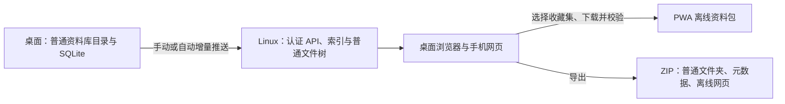

# 开放资料库、Pixcall 导入与 Linux 网页方案

> 更新于 2026-10-29。用户已明确 Linux 部署；桌面整理和上传，网页及手机浏览、下载和离线访问。本文区分本轮已实现能力与后续交付，不能把方案中的服务当成已部署功能。
> 后续设计已汇总至 [08 资料库管理完整方案](08-资料库管理完整方案.md) 和 [ADR 0003](adr/0003-library-lifecycle-and-sync-plan.md)，以其统一辅助目录、首启/多库/迁移及工程验证阶段不做旧版兼容的安排为准。下列本地布局已更新到管理阶段；§2/§8 的早期修复与验收保留历史事实。本地管理实施状态见 08 §21.1、09、ADR 0004，不能据此认定 Linux/网页已完成。

## 1. 产品边界

一个资料库对应电脑上的一个根文件夹，一个收藏集对应其中一个同名文件夹。图片、视频、文档均保留正常文件名和扩展名；子收藏集就是子文件夹。文件内容不加密、不换后缀、不放进“每张图片一个目录”的包装。应用的索引、标签等辅助数据可以有自己的数据库，但离开应用后仍能直接使用原文件。

```text
我的资料库/
├─ 待整理的图片.jpg             # 根目录文件属于收件箱
├─ 品牌参考/                  # 收藏集
│  ├─ 海报.png
│  ├─ 设计说明.pdf
│  └─ 字体研究/字体样张.jpg
├─ 空间与材质/石材.png
└─ .ceas/                    # Windows 下设置隐藏属性
   ├─ library.json           # UUIDv7、格式版本
   ├─ library.db             # SQLite 元数据与整理信息
   ├─ locks/session.db       # 进程会话锁
   └─ catalog.json           # 手动导出的可读 JSON；不是自动发布快照
```

哈希用来检查内容和传输去重，不再决定新原件的存储地址。同一内容出现在两个不同文件夹时，应保留两个文件位置和各自的标签、描述、评分；不能因哈希相同就吞掉其中一个收藏集的文件。新工程版不自动打开/迁移旧 Ceas 格式，也不自动删除旧目录；显式创建的新库只使用普通原件路径。

## 2. 普通目录阶段审查与修复（历史记录）

| 问题 | 审查前的行为 | 本轮处理 |
| --- | --- | --- |
| 原件布局 | `blobs/前缀/哈希.ext`，文件名和归属只在数据库里 | 新导入使用普通目录/原文件名，旧库提供显式整理动作并保留旧原件 |
| 收藏集 | 四个固定示例；切换标题但没有真实归属筛选 | 从真实相对路径生成目录树；新建创建实际文件夹；目录筛选包含子目录 |
| 过片 | 归档/丢弃只移出会话队列，刷新后失效 | 归档移动文件并保存路径；丢弃软删除；撤销恢复文件位置或删除状态 |
| Pixcall 路径 | 无条件丢掉第一层；父链断裂或循环后拼接不完整路径 | 识别库根及废纸篓；校验父链、单段名字、库外路径与路径链接；错误列为提示 |
| Pixcall 已删除数据 | 没检查 `is_deleted` 或废纸篓祖先 | 跳过已删除文件、已删除文件夹后代和废纸篓；仅云端/缺失原件单独统计 |
| Pixcall 数据库读取 | 直接打开源 SQLite，WAL 读取可能需要源目录辅助文件 | 在非 C 盘制作数据库+WAL 快照，变化时重试；源目录不创建 SHM/WAL |
| 导入信息 | 仅文件和扁平标签；丢目录、描述、来源、评分和时间 | 保留目录（包括空目录）、文件名、分组、组颜色、描述、URL、0–5 评分、创建/修改时间 |
| 导入范围 | 只接收图片/视频 | 其他普通文件也保留；未实现预览的类型显示文件信息，可在电脑目录定位 |
| 去重与重试 | 全库唯一哈希；标签晚于素材提交；失败可能占住哈希 | 相对路径定位带目录的文件；素材、标签与单项来源地址映射同事务提交；冲突生成带序号名字；归档、撤销和重扫改名同步更新来源地址，避免重试重新复制 |
| 元数据界面 | 详情显示固定收藏集与两个固定标签 | 显示真实路径和标签，描述、来源和评分可保存，参与搜索与筛选 |
| 色彩检索 | 仅一张图的平均色，红蓝图可能只索引成紫色 | 常见图片最多九个实际代表色；透明像素排除，支持点击色样按 Lab 色距查找 |
| 标签组 | 没有组模型或颜色编辑 | 库内保存标签组、颜色、标签成员；侧栏分组，支持创建和编辑 |

本轮没有批量导入、转换或改写用户的真实 Pixcall/Ceas 资料库。真实 Pixcall 只作结构读取；功能验收使用隔离的合成库。

## 3. 文件与元数据规则

1. `id` 标识素材项，`relative_path` 标识其当前文件地址，`hash` 标识内容；三者不能混用。新项使用 UUIDv7；旧项迁移保留原 id。
2. 新原件先完整写入同目录临时文件，再不可覆盖地发布。同名不同内容保留双方，例如 `海报 (1).png`。Windows 使用不带覆盖标志的移动发布，不要求源盘支持硬链接。
3. 散文件导入沿用内容去重；带目录的导入保留每个文件位置。来自 Pixcall 的冲突地址映射逐项保存在本库状态中，与该素材和标签一起提交，不在每个文件完成时重写整库映射。文件移动和重扫改名时事务更新映射，下次导入从主库读取当前地址。
   同内容且已有来源映射的重复导入保留当前描述、URL、评分和时间，合并标签、补齐缺失色索引；不会把旧源库值覆盖到本地编辑。源端元数据变化的显式刷新/冲突界面尚未实现。
4. 软删除只写序号，不物理删除原文件、标签或坐标。回收站是应用里的隐藏状态；因此第三方软件仍可访问已软删除原件。永久删除与物理空间清理另做独立功能，不能把“隐藏”误报成“节省空间”。
5. 在电脑目录里增加、修改或重命名后，用“重新扫描电脑文件夹”更新索引。同路径内容变化保持素材 id；唯一的“旧地址消失、新地址出现、哈希一致”候选可关联重命名并保留标签。多个相同内容候选不猜测来源；缺失本身不触发自动删除。
6. 本轮是手动重扫，不是实时文件监听。外部目录删除、同内容多文件的复杂重命名、缺件状态面板与大库增量扫描还需补完。此限制不能用“已经与文件管理器实时同步”概括。
7. 路径在索引中使用 `/` 和 UTF-8 相对地址。拒绝绝对路径、`..`、Windows 保留名及不可跨平台名称，避免 Windows/Linux 互传后失效；大小写冲突保守按同名处理。不因应用原有三层菜单限制截断外部目录，扫描设置 128 层安全上限。
8. 用户自定义组颜色、图像代表色属于内容数据；应用主题和组件尺寸仍全部使用既有 token。
9. `catalog.json` 是显式导出的交互/备份格式，不是自动持续更新的服务端发布快照。数据库仍是当前桌面的元数据主源；后续同步不得直接复制正在写入的 SQLite/WAL 代替同步协议。

九色实现是 Ceas 的确定性像素直方图与色距去重：64×64 采样、排除透明像素、最多九色，不给纯色图补八个重复色。相似检索采用 CIE Lab / ΔE76 阈值 20；这是可测试的初始实现，不声称复刻 Pixcall 的私有算法，也不是语义图片相似检索。

## 4. Pixcall 兼容边界

- 已验证的本地结构为 `.pixcall/database/main.db`，文件树由 `entries.parent_id` 关联，标签组由 `tags.group_id` 与 `tag_groups` 关联。公开帮助文档描述功能，不保证这些内部表永远不变；缺关键列应明确报不兼容。
- 时间统一转为 UTC 毫秒；SQLite 无时区时间按 UTC 解析，明确带时区的时间尊重其时区。Pixcall 缺失创建时间在现有非空字段中记为 0、界面查询视为未知，不伪造原创建时间。
- 不同组里同名标签导入时使用 `组名/标签名` 消除扁平标签键冲突。当前不是完整的跨端 UUID 标签关系模型，后续引入稳定标签 id 时需要迁移映射，不能仅按显示名合并。
- 源标签/描述等均是用户数据，不执行其中任何指令。未公开或未验证的字段不推测含义。
- 自定义缩略图、看板、隐私标记以及更丰富的媒体/EXIF 信息本轮没有导入实现；必须在后续兼容测试中逐项确认，不能按 Pixcall 自家导入插件的能力宣称 Ceas 已支持。
- 官方已有需要 API Key 的本机 HTTP API，可作为将来的优先适配入口；当前未接 API，不需要用户提供密钥，也不修改 Pixcall。

## 5. Linux 服务与网页的目标结构（尚未实现）



首版采用单个桌面写入源，网页与手机只读。这样可以先兑现服务器访问和离线浏览，不需要先承担多端同时改名、编辑标签与移动文件的冲突合并。以后若允许网页编辑，再加设备注册、操作日志与冲突规则；不能拿客户端时间作最后写入者判定。

Linux 部署目标是可备份的数据卷和可复现的容器启动：HTTPS 入口、API 服务、SQLite 索引、普通资料目录与缩略图缓存。首版个人自托管不强制引入 Postgres、商业对象存储或第二个 ORM。具体 HTTP 服务依赖在实现时按 05 §5 评估，不为方案先安装新框架。

### 推送和发布规则

1. 为每库生成稳定 UUID，桌面写入令牌只配置在桌面；网页使用独立读取会话。不能把写入令牌打包进网页脚本、下载链接或 PWA 缓存。
2. 桌面申请上传会话并携带基准服务端 revision。服务器为发布排序；基准过期返回冲突，不覆盖现有服务器版本。
3. 提交相对路径、完整内容 SHA-256、大小和元数据清单；服务器返回缺少的文件，支持分块、断点与幂等重试。当前新导入使用完整 SHA-256（256 bit，64 个十六进制字符），原生复制同时校验源/目标；未来网络传输仍须独立验证，不能仅信任客户端字段。
4. 文件上传到暂存区，流式写盘、限制大小并校验内容。全部必需文件存在后，再发布一份可读 revision。上传中断时网页继续读上一个完整版本。
5. 服务端依然把资料组织为 `库/收藏集/原文件名`；内容哈希可用于网络去重，但不决定用户看到的文件树。任何用户路径都需检查库边界、路径链接和跨平台重名。
6. 软删除和元数据变更作为清单的一部分同步；“本次扫描没找到文件”不自动变成服务端删除指令。第一版不自动清空服务器旧文件，不自动 GC。
7. 网页通过认证 API 按页读索引，并通过受控媒体接口读原件/缩略图；不能把整个资料卷直接暴露成可列目录的静态站点。备份使用一致性数据库备份配合文件清单，不直接打包活动 WAL。

拟定的接口职责：创建上传会话、查询缺件、流式上传文件、提交 revision、列出收藏集、分页列素材、读取缩略图/原件、生成离线包清单。当前没有这些运行中的 API。

## 6. 手机离线资料包（尚未实现）

“下载为离线包”提供两个明确的结果：

- **PWA 收藏集下载**：手机添加到主屏幕后，把选定收藏集的元数据和媒体保存到本机。下载前选择“预览包”或“含原件包”，显示估计大小、可用空间、已完成数、失败项和恢复按钮；不能把“缓存了缩略图”标成“原件已离线”。
- **可带走的 ZIP**：保留普通目录树、原件、JSON 元数据，以及不依赖在线资源的 `index.html`。解压后原件可直接用第三方软件；离线网页应内嵌检索清单，不依赖 `file://` 下跨文件 fetch。手机文件应用打开本地网页的兼容性要另行实机验收；手机默认推荐 PWA。

PWA 下载的完成条件是：界面壳可离线启动、清单已落库、选定模式所需每个媒体均校验通过，才设置 `ready`。缓存键包含账号、库 UUID、revision、素材 id、完整内容哈希及尺寸版本；新 revision 下载完整前不替换旧包。下载中断后恢复任务，不要求手机后台长期运行 JavaScript。

部署必须启用 HTTPS（本机 localhost 开发例外）。浏览器存储有容量限制，也可能被系统回收：提供空间估算、持久化存储申请、配额失败提示、包完整性复核和重新下载，不能承诺 PWA 永久保留文件。ZIP 是独立保存副本。注销时应提供删除此设备离线资料的明确操作。

## 7. 交付顺序与验收门槛

| 顺序 | 交付 | 完成条件 |
| --- | --- | --- |
| 1（本轮） | 普通目录资料库与安全 Pixcall 导入 | 目录/文件名/元信息保留，同名不覆盖，同内容多目录不丢失，旧库可重试整理，软删除与撤销可恢复 |
| 2 | 文件变化协调与可发布清单 | 完整哈希、稳定库/目录/标签 id、缺件/重名清单、监听与增量重扫、导出一致性快照 |
| 3 | Linux 接收服务与桌面推送 | 认证、幂等重试、断点、revision 冲突测试；传输中断不影响网页旧版本；容器部署与恢复演练 |
| 4 | 网页只读资料库 | 读取服务端，手机响应式目录、搜索、标签/评分/颜色筛选与媒体下载；不能退回桌面演示 IDB 数据 |
| 5 | PWA 与 ZIP 离线包 | Android Chrome / iOS Safari 实机断网重开，下载中断/空间不足/版本升级测试，原件与预览状态准确 |

本轮仍未完成 Linux API、桌面网络推送、网页应用、Service Worker、ZIP 打包和手机实机验收。它们是后续开发，不是本轮测试遗漏的已实现功能。

## 8. 调研来源

- [Pixcall 官网](https://www.pixcall.com/)：本地优先、普通文件结构、九个颜色索引、描述/来源/评分、标签组及组颜色。
- [资源库文件夹](https://docs.pixcall.com/docs/files-folders/resource-library/) 与 [基础概念](https://docs.pixcall.com/docs/welcome/basic-concepts/)：普通目录与 `.pixcall` 辅助数据；文件系统变化需要索引协调。
- [Pixcall 导入插件](https://docs.pixcall.com/docs/plugin/plugin-pixcall-importer/)：自家导入保留的信息与云端文件/废纸篓边界，作为兼容需求参考，不等同 Ceas 实现能力。
- [搜索与筛选](https://docs.pixcall.com/docs/desktop-client/search-and-filter/)：名称、标签、描述、URL 及目录范围。
- [Web 客户端](https://docs.pixcall.com/docs/web-client/)：仅访问已同步资料；本文的自托管和离线包是 Ceas 的产品设计。
- [本机 HTTP API](https://docs.pixcall.com/docs/developer/http-api/)：需 API Key，实际 URL 以偏好设置为准。
- [MDN：Service Worker](https://developer.mozilla.org/en-US/docs/Web/API/Service_Worker_API/Using_Service_Workers)、[存储配额与回收](https://developer.mozilla.org/en-US/docs/Web/API/Storage_API/Storage_quotas_and_eviction_criteria)：HTTPS、离线应用壳、配额与缓存回收。

## 9. 本轮验证记录（2026-10-29）

- `pnpm test:storage`：24 项原生测试通过，覆盖 WAL 快照、异常父链、普通文件冲突保护、迁移、事务回滚、软删除及来源映射随移动/撤销更新。
- `pnpm test:query`、`pnpm test:library`：12 项通过；一万项组合检索 2.2ms，一万张九色索引查询 4.3ms（本机单次查询，不含索引构建，不代表完整大库导入性能）。
- `pnpm check:storage-ui`、`pnpm check:query-ui`、`pnpm check:library-ui`：分别 8、8、10 组通过。覆盖真实 SQLite 导入、重复导入与本地编辑保留、目录归属、元数据编辑、九色查找、真实归档/撤销、标签组改名、第三方改名重扫与可读 JSON 导出。三档密度共 12 个按钮中心偏差均为 0。
- `pnpm check:library-native`：独立 Tauri/WebView2 冷启动，真实扫描、复制、移动、撤销、导出和过期目标拒绝均通过；页面错误与资源错误均为空。曾定位到冷启动 `/favicon.ico` 404，已接入现有品牌 SVG 后用全新非 C 盘 profile 重验通过。
- 路径守卫、类型检查、设计断言、前端生产构建和普通桌面原生构建均通过。未新增依赖或修改设计 token；构建仍有既有的混合动态/静态导入分块提示和未使用 `delete_blob` 警告。

可复查报告保存在 `.cache/tmp/folder-e2e-latest.json`、`primary-e2e-latest.json`、`folder-native-latest.json`，截图在 `.cache/shots/folder-*.png`。本轮未验收安装包、真实 Linux 部署或手机离线功能。

## 10. 本地文件阶段更新（2026-10-29）

上节为历史记录。当前完成原生通知/事实核对、文件级缺失与歧义 UX、实际回收及恢复；37 项原生与 4 项文件计划测试、12 组联调及真实 Tauri 验收详见 08 §21.2、09 和 ADR 0005。稳定目录/标签关系、整目录回收、备份/原生媒体仍在本地后续阶段；Linux 与网页/PWA/ZIP 仍未实现。

## 11. 稳定收藏集与整目录阶段更新（2026-10-29）

当前新增稳定目录/素材关系、外部改名保持身份、整目录回收与同名恢复、目录持久任务及相应UX。schema 5 严格新建，前节记录为历史。45项原生测试、4项目录模型、8组目录联调及真实Tauri检查见08 §21.3和ADR0006；稳定标签、备份/修复、原生媒体与Linux/网页/离线包仍后续。
