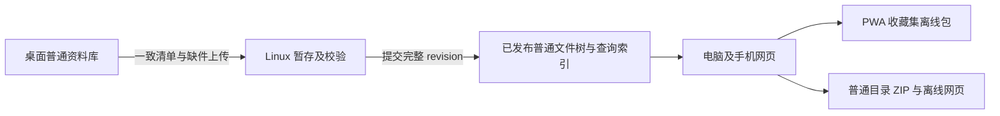

# Ceas 资料库管理完整方案

> 版本：实施基线 v2 · 2026-10-29。
> 阶段：工程可行性验证。用户已明确“开工”；本地资料库基础管理已落地，P2 部分完成。完整状态与证据见 §2、§21.1，未完成的方案条目仍是后续要求。
> 实施边界：本次使用独立合成测试库，不重建或迁移用户已有库，不部署服务器；不安排旧版 Ceas 自动兼容。
> 文档关系：05 的工程硬约束、01 的视觉不变量和 04 的吉祥物规则继续有效。本文汇总资料库后续设计，补充 00，并更新 07 的后续方向；07 的历史实现与测试记录保留原意。设计决策见 ADR 0003。

阅读导航：目标与当前差距见 §1–2；目录与身份见 §3–4；首次引导和资料库操作见 §5–9；文件、回收站与整理信息见 §10–12；反馈与同步离线见 §13–17；工程边界、实施顺序和验收见 §18–22。

## 1. 目标与本阶段范围

让用户自由选择资料盘、创建或使用普通文件夹作为资料库，持续用 Ceas 或第三方软件管理原件。多个库可以共存、改名、换盘和重新定位；首启有吉祥物和可跳过、可重开的引导。后续由桌面向自托管 Linux 发布资料，网页和手机浏览并下载离线包。

本阶段允许调整目录、模型和索引结构，不安排旧版 Ceas 数据自动迁移、旧格式兼容或双轨读写。测试库重建也必须是独立、明确的操作，列出影响范围；本方案编写过程中不执行重建。Pixcall 是外部导入来源，其格式识别和源文件保护仍属于导入功能。

### 1.1 基本约定

1. 一个库对应一个根文件夹；一个收藏集对应其中一个同名子文件夹；允许嵌套和空收藏集。
2. 原件保留正常文件名、扩展名和内容，不以每张图片一个包装目录的形式存放。
3. 多个库可以位于不同磁盘；首版单窗口一次操作一个当前库，各库独立保存整理信息。
4. 库身份独立于名称、位置和内容哈希；改名、迁移、重新定位保留身份。
5. 创建、打开、导入、切换、迁移和重新定位是不同操作，分别校验和反馈。
6. 本地库无需服务器登录；每库可单独启用同步，首版桌面保留完整原件。
7. 文件与 SQLite 不能假定属于同一原子事务；跨边界操作有持久任务记录和恢复过程。
8. 删除使用软删除和读时可见性谓词，不向后代级联写入删除标记。
9. 文件变化核对、服务器发布和手机离线下载是独立过程，分别显示状态。
10. 一切实现继续遵守非 C 盘写入、单一依赖、token、目录分层和交付证据要求。

### 1.2 参考 Pixcall 后的取舍

| 参考能力 | Ceas 的设计 |
| --- | --- |
| 普通文件夹加隐藏辅助目录 | 采用；辅助数据统一规划到 `.ceas`，按原件、人工信息、派生缓存分类 |
| 本地库和同步库 | 同一资料库内核，加可选服务器连接；一个服务器可承载多个独立库 |
| 启动时指定库 | 软件可进入欢迎/管理/帮助页；进入素材工作区前需要有效库 |
| 磁盘与客户端对应 | 监听加核对兜底，提供进度和缺失/冲突入口 |
| 手动关闭后改名、搬库 | 提供应用内操作和外部搬移后的重新定位 |
| 仅云端文件 | 暂缓；首版桌面保持完整本地原件，手机单独选择离线内容 |
| 商业账号限制 | 不引入“一个账号只能一个同步库”的产品限制 |

## 2. 当前实现与目标的区别

以下为本地管理实施后的状态；目标列仍包含后续阶段，不能用本次局部测试替代整张验收矩阵。

| 能力 | 当前实现 | 本方案目标 |
| --- | --- | --- |
| 普通原件布局 | 新导入已保留目录和原文件名 | 统一辅助目录、身份及文件操作协议 |
| 核心元数据 | `.ceas/library.db` 保存素材、标签、描述、评分、颜色等；manifest 与数据库核对库身份 | 稳定目录/标签关系、备份与修复 |
| 新建/打开/切换 | 独立创建/探测，最近库列表，会话代次校验和进程占用锁；导入完成/停止后切换 | 继续补全全类型编辑/后台任务屏障 |
| 首启 | idle 吉祥物欢迎页，新建/打开/导入、稍后设置、逐步跳过、可重开引导 | 引导版本与逐项学习记录 |
| 改名/整库迁移 | 显示名、可选根目录改名、复制并全哈希校验迁移、启动恢复；原副本保留 | 文件级续传、历史任务管理/旧副本清理 UI、跨物理卷实测 |
| 外部变化 | 手动重扫，部分唯一哈希候选可关联改名 | 监听、增量核对、明确缺失和歧义处理 |
| 回收站 | 软删除隐藏，原件留在原位置 | 软删除加库内回收区，恢复位置与冲突处理 |
| Pixcall 导入 | 保留目录/空集/元数据/组颜色，来源预览与目标选择，完整 SHA-256 原件复制校验、停止后安全切换 | 更完整任务历史、源端元数据更新冲突界面 |
| Linux/网页/离线 | 仅有方案 | 分阶段实现并独立验收 |

打开和读取现在要求已有合法 manifest/数据库且不带 CREATE；失败不创建目录或数据库。原地建索引的目录消失也拒绝建立替代空目录。运行配置损坏时保留原文及备份进入管理页；任务记录损坏显示恢复错误。旧版自动初始化和自动迁移入口已退出当前调用链。

## 3. 目录结构、数据归属与携带范围

```text
我的参考库/
├─ 待整理.jpg                   # 根目录素材属于收件箱
├─ 品牌参考/
│  ├─ 海报.png
│  └─ 子收藏集/包装.png
├─ 空间材质/石材.jpg
└─ .ceas/
   ├─ library.json              # 库身份和格式版本
   ├─ library.db                # 人工信息、对象关系、任务和同步元数据
   ├─ cache/                    # 可重建缩略图、检索与媒体派生文件
   ├─ trash/                    # 回收区原件；不是缓存
   ├─ staging/                  # 有任务归属的未完成操作
   ├─ exports/                  # 显式导出的可读清单
   ├─ backups/                  # 带版本/校验信息的元数据快照
   └─ locks/                    # 当前设备会话运行信息
```

`.ceas` 名称保留给系统使用，扫描不将其内容当普通素材。Windows 需要实际设置隐藏属性，不能依赖文件名带点。除根系统目录外，不因一个普通文件以点开头就无提示忽略；忽略规则须可查看，原件与合法收藏集不得被历史特殊名称静默排除。

| 数据 | 权威来源 | 携带/清理规则 |
| --- | --- | --- |
| 原件、文件名、实际位置与内容 | 文件系统 | 正常文件和回收区原件都属于需要保存的数据 |
| 描述、来源、评分、标签、分组、画板 | 库内数据库 | 随库迁移和备份；不能从原件完整推回 |
| 库 UUID、格式版本 | `library.json`，数据库记录同一身份以便核验 | 身份不一致进入诊断，不能自动选一份覆盖另一份 |
| 库显示名称 | 数据库；根文件夹名作为不可读取时的显示回退 | 初始与根目录名一致，之后允许不同 |
| 缩略图、颜色特征、搜索索引、代理文件 | 从原件和人工信息生成的缓存 | 记录算法/尺寸版本，允许独立重建 |
| 最近库、上次当前库、引导进度、设备凭证 | 非 C 盘本机配置目录 | 不随普通整库复制扩散登录凭证 |
| 收藏集、画板布局和每库视图位置 | 库内数据，视图偏好按设备区分 | 不跨库混用；主题和密度属于应用偏好 |

库内文件地址使用 UTF-8 相对路径。绝对根路径只保存在本机登记和操作恢复记录中，不作为素材主键。导入来源历史可以保存原始来源路径，但不能依靠它打开当前库的原件。

完整可携带副本包含正常原件、回收区原件、核心元数据和必要恢复信息；缓存可选。可读 JSON 导出不等于完整备份，自动元数据备份采用批次/空闲或危险操作前的快照，不在每个文件导入后重写整库清单。

## 4. 身份与领域对象

| 对象 | 核心信息 | 身份规则 |
| --- | --- | --- |
| Library | `library_id`、显示名、格式版本、创建时间 | UUIDv7；迁移/改名/恢复保留 |
| Folder/Collection | id、父目录 id、文件夹名、删除序号 | 名称对应真实目录；改名保持 id |
| Item | id、目录 id、文件名、完整哈希、大小、类型、时间、文件状态 | UUIDv7；同内容的不同位置可为不同素材 |
| Metadata | 描述、来源 URL、评分、标签关系、画板引用 | 归属素材 id，不能仅按文件名或哈希匹配 |
| Tag/TagGroup | 独立 id、名称、组成员、组颜色 | 重命名保持 id；不同组允许同名标签 |
| LibraryRegistration | 库 id、规范根路径、最近使用时间、已知卷信息 | 属于本机，路径相同或别名不新增重复条目 |
| Task/Operation | id、库 id、操作类型、阶段、源/目标、校验信息、错误 | 持久记录，重启可诊断或恢复 |
| ServerBinding | 服务器身份、远端库身份、发布版本、写入设备任期 | 凭证单独保存在本机，不进入共享包 |

路径是位置，哈希是内容指纹，id 是对象身份。首版新格式使用完整 SHA-256（256 bit，表示为 64 个十六进制字符）做复制/传输校验。目录路径可以由父链解析并缓存；目录改名后的路径缓存可批次更新，目录软删除则通过祖先可见性谓词影响后代，不逐条写删除标记。

备份保留原库身份；恢复时验证后重新登记位置。建立独立副本则新建库身份并重映射库内对象 id、标签/目录/画板引用，默认关闭服务器连接。出现同一库身份的两个位置时，提供“重新定位原库”“建立独立副本”“取消”，不把两个版本自动合并。

## 5. 入口、欢迎页与可重开的引导

### 5.1 入口布局

首次无登记库时进入欢迎页：已有眼珠球吉祥物、简短说明、三项入口“新建资料库／打开资料库／导入资料库”，以及“稍后设置”。已有最近库时，在同一管理界面展示库列表。资料库名称和路径可查看与复制，不依赖鼠标悬停才能获取完整信息。

主界面顶部显示当前库名，下拉显示最近库及新建、打开、导入、管理入口。设置和首次欢迎页复用相同管理能力。帮助或设置中固定提供“新手引导”。

后续启动默认打开上次成功使用的库；原位置不可用或上次已关闭库时进入管理页。完整欢迎介绍只自动出现于首次，已跳过/完成后不反复强迫教学；未配置库仍显示可直接操作的精简入口。

| 页面/面板 | 核心内容 | 主动作与退出行为 |
| --- | --- | --- |
| 欢迎页 | 吉祥物、资料库说明、三入口、稍后设置 | 打开相应流程；跳过进入管理页 |
| 资料库管理 | 最近库列表、当前库、状态、路径和数量详情 | 新建/打开/导入；条目菜单含改名、迁移、重新定位、备份/独立副本、移除最近记录 |
| 创建表单 | 空库/已有普通目录分支、名称、位置、最终路径预览 | 预检后创建；取消返回，执行前无建库副作用 |
| 导入预览与任务 | 来源、目标、目录/元数据范围、缺件/冲突、处理进度 | 开始、暂停、停止、失败项重试和导出清单 |
| 库名与位置设置 | 显示名、当前路径、可选根目录改名、新位置预览 | 提交对应任务；失败保留原状态和输入 |
| 恢复/诊断页 | 位置不可用、占用、损坏或未完成任务的具体原因 | 重新定位、重试、查看备份/任务、打开其他库 |

首次选择和以后打开均展示实际库根位置。新建的父目录/名称可以分开填写并实时预览；重新定位则只选择完整根目录，避免重复手填名称导致指向错误目录。

### 5.2 引导与真实操作分开

| 步骤 | 内容 | 跳过结果 |
| --- | --- | --- |
| 欢迎 | 吉祥物、资料库概念、三项入口 | 进入未配置管理页 |
| 选择/建立库 | 名称、位置、来源与目标说明 | 保持当前库或未配置状态，不假装已建库 |
| 认识文件夹与导入 | 收藏集对应目录、原地索引与复制导入 | 继续下一项 |
| 认识搜索与整理 | 标签、评分、颜色、归档与回收站 | 继续或结束 |
| 可选服务器连接 | 介绍 Linux 同步，实施阶段再提供可执行连接 | 保留本地库 |
| 完成 | 按实际状态给出“进入资料库”或“稍后设置” | 随时退出 |

每个教学步骤都有返回、下一步和跳过，也可结束整段引导。必要创建字段未完成时，“创建/执行”不可用，用户仍可退出或稍后设置。正在执行的文件操作提供真实取消/停止，不能用“跳过”掩盖未完成任务。

引导进度属于应用，记录版本、已看/已跳过步骤；切库不强迫重看。重新查看可继续或从头开始，保留当前库和浏览位置，不自动重复创建、导入或连接服务器。后续新增引导内容仅提示新内容，不抹掉此前进度。

### 5.3 吉祥物与视觉约束

欢迎页作为启动窗口使用现有 `idle` 形态；空库和错误页沿用 04 允许的位置，完成反馈使用静态形态和克制轻提示。不在普通表单步骤、工具栏和骨架加载中反复摆放，不把眼睛当进度指示器。跟随光标仍仅用于关于页，减少动效时保持静态。

尺寸、颜色、间距、圆角与时长均引用现有 token 和 01/04，不在本方案另设视觉数值。状态同时使用文字和图标；三档密度、明暗、长名称、长路径、大字体、窄窗口、键盘焦点和对话框回焦均列入验收。桌面保持既有窗口最小尺寸约束，手机网页单独响应式设计。

### 5.4 UI/UX 设计审查与开工前交付

2026-10-29 实施更新：[09 界面与交互设计](09-资料库界面与交互设计.md) 和 [独立可点击原型](design/library-management.html) 已交付本地阶段页面及状态，生产界面沿用同一主题/密度 token。服务器、离线、诊断/备份等后续页面仍按各阶段单独补齐。

开工前按下表补齐独立设计稿。线框可采用设计工具或静态标注图，关键流程原型只模拟交互，不接真实文件操作；不要求先编写前端业务代码。

| 页面组 | 需要确定的 UI/UX 内容 | 对应验收 |
| --- | --- | --- |
| 欢迎与引导 | 吉祥物、主次入口、稍后设置、步骤进度/返回/跳过/结束；有库与无库的完成页区别 | A01、A26 |
| 最近库与管理页 | 列表信息顺序、同名库的路径区分、当前项和状态、空列表、数量未知、条目操作菜单 | A02、A05、A07 |
| 创建、打开与重新定位 | 表单分组、原生目录选择前后、最终路径预览、预检与结果摘要、字段错误和类型分流 | A02–A04、A09、A15 |
| 工作区库切换入口 | 与现有面包屑/居中视图胶囊的布局关系、下拉范围、长库名/滚动、切换中和失败回退 | A05–A07、A26 |
| 名称与位置管理 | 显示名和真实目录名的区别、可选目录改名、新旧路径预览、提交与失败保留输入 | A08–A10 |
| 迁移任务与恢复 | 预检/复制/校验/激活各阶段的进度、可停止边界、任务收起后入口、旧副本清理和重启恢复页 | A10–A12 |
| 导入预览与结果 | 来源/目标、缺件与冲突、可保留的元数据、后台进度、部分成功、失败项重试/导出 | A06、A13、A18 |
| 回收、缺失与恢复 | 三类状态区分、原位置/目标位置、同名冲突、保留双方、恢复结果和失败重试 | A14、A16、A17 |
| 服务器与离线（后续阶段） | 本地/网络/离线各自状态、授权、版本/大小、暂停/解绑、包不完整和空间不足 | A20–A25 |

各页除正常态，还要给出适用的空态、加载/预检态、字段错误、失败、不可用、部分完成和成功态。未配置库、已打开空库、筛选无结果、位置丢失和数据库损坏采用对应说明与主动作，不能共用一个含糊的空白页。

交互规格至少明确以下内容：

1. 页面使用完整页面、面板、下拉还是确认对话框；层级和返回路径固定，避免连续堆叠模态框。
2. 每个状态的主/次按钮名称、可用条件、执行结果及原因说明；禁用原因在附近可读，不能只靠悬停提示。
3. 区分“跳过教学”“取消未执行设置”“停止正在执行的任务”“关闭面板”；Esc、点遮罩、返回与退出应用分别约定，不能隐含删除任务或数据。
4. 长任务收起后有固定入口和状态；不可中断阶段显示原因和等待结果，不能让用户误以为已经停止。导入进度继续使用非阻塞反馈，避免遮挡过片等操作。
5. 原生目录选择器取消、输入保留、异步结果返回、保存失败重试及快速重复点击的行为明确；只在必要后果确认时阻塞。
6. 键盘初始焦点、Tab 顺序、模态焦点约束、Esc 回焦、错误播报与减少动效完整；进度更新不持续抢焦点或逐帧播报。
7. 页级状态提示、字段说明、轻提示和任务详情各有职责；“本地已保存”“磁盘已核对”“服务器已发布”“本机可离线”使用准确文案。
8. 设计稿标注对应的现有 token、通用组件和图标出口；未实现的服务器/离线功能不提供会误报成功的入口，也不先把后续页面塞进本地首启步骤。

设计评审走查至少包含：无库首启全跳过后重开引导；创建/打开取消与错误目录；导入中切库；迁移失败/重启恢复；外置盘丢失后重新定位。服务器和手机离线原型在各自阶段开始前补齐。

UI/UX 就绪证据为页面线框、关键流程可点击原型、带状态的按钮/文案规格和走查记录。本地已形成原型及真实界面走查证据；这不代表九组后续页面和 A26 全部完成，细节见 09 与 §21.1。

## 6. 创建、打开和导入

### 6.1 创建空资料库

选择父目录、填写自定义名称，展示最终完整路径。预检名称、权限、可用空间、文件系统能力和库嵌套；已有同名目录不得自动覆盖或并入。点击“创建”前只预览，不建立目录或元数据。

创建生成身份，在受控临时位置准备并验证元数据，完成后发布系统目录；最后登记并激活。失败清理仅限本次任务新建的临时数据；有已有文件的目录不能递归回滚删除。发现未完成创建时提供恢复/取消；不能把半成品识别为健康库。

### 6.2 使用已有普通文件夹建立资料库

作为明确的创建分支，说明“文件保持当前位置，Ceas 将建立索引”。预检目录中的现有系统目录、嵌套资料库、不可支持名称和不可读文件。已有合法 Ceas 库转“打开”，Pixcall 库转“导入”，未知或损坏 `.ceas` 转诊断。

确认后建立核心元数据并后台索引；逐步显示已发现文件和处理状态，无需等全部缩略图完成才浏览。外部新增内容在预检与提交期间仍需再次核对；禁止按扫描未发现就自动删除资料。

### 6.3 打开已有资料库

直接选择完整根目录，不要求再手填目录名。用不创建文件的探测流程检查路径、manifest、数据库、身份与格式、未完成操作和写入占用；候选库验证成功后才替换当前会话及上次使用记录。

普通目录提示“建立资料库”，其他软件的库提示“导入”，缺失/损坏/版本不支持进入相应说明。打开过程中禁止调用自动建库接口。目录存在不等于资料库有效，选择文件、只读目录、非法路径和被占用库必须明确反馈。

### 6.4 导入普通目录、散文件或 Pixcall

先选来源，再选目标（新建或已有 Ceas 库），预览文件数、大小、目录和缺件/冲突。普通目录默认复制并保留层级；原地管理通过 6.2 进入。源与目标相同或相互包含时阻止执行，避免递归导入。
窗口内拖放不弹预览：落点取当前导航位置 —— 单个文件落到收件箱或当前收藏集；**文件夹始终保留层级**
（在「全部素材」下顶层目录成为收藏集，收件箱不增加）；标签与搜索结果回落到库根；回收站不接收。
批量拷贝全程无模态（见 [10](10-下一步计划.md) §2）。

Pixcall 按已验证的来源结构读取目录、空集、标签组/颜色、描述、来源、评分和时间，跳过废纸篓、删除后代及缺失/仅云端原件；不修改源库。不将 Pixcall 内部格式永久稳定作为前提，缺关键结构明确报错。看板、自定义缩略图、隐私标记和完整 EXIF 需要独立验证，未支持时在预览中列明。

导入任务有进度、暂停、停止、重试和失败清单；完成部分保留。源对象映射与素材及标签同事务提交，重试不重复复制、不用旧来源值覆盖本地人工编辑。源端后续改名或元数据更新按来源身份及明确刷新策略处理，不自动删除目标。

普通文件保留；不支持预览的类型显示文件信息和定位/下载入口。损坏文件、超大文件、磁盘满、源文件处理中被改动等应形成可定位的失败项，不能伪报整批成功。

## 7. 多库共存与切换

列表显示显示名、完整路径入口、当前/可用/未连接/处理中状态、最近使用和有依据的数量。加载中或未知数量显示对应状态，不显示为零。允许同名不同路径；规范路径别名和重复打开定位到原条目。

切换顺序：探测目标 → 处理当前未完成操作 → 保存人工编辑和视图位置 → 停止旧会话任务并等待写入屏障 → 验证并激活目标 → 恢复目标视图 → 更新登记。目标失败则保留原会话；任何延迟回调都必须核对库 id 与会话代次。

| 当前情况 | 切换处理 |
| --- | --- |
| 正常使用 | 保存后直接切换，轻提示即可 |
| 有未保存表单 | 提供保存并切换、放弃本次编辑、留在当前库 |
| 正在导入 | 提供完成后切换、停止后切换、留在当前库；仅暂停不代表可安全切换 |
| 正在上传 | 停在可恢复边界，保留待上传记录；不影响另一库单独连接 |
| 正在迁移/根目录改名 | 同一库管理操作互斥，显示当前阶段和可用的取消入口 |
| 目标未连接/损坏/被占用 | 展示原因，提供重新定位、重试或选择其他库 |

每库素材、收藏集、标签、画板、回收站和视图位置独立。切库清空临时多选和临时查询，关闭详情与旧对话框；应用主题/密度和引导进度沿用。正式目标库激活前不显示其旧缓存为“当前库”。

“从最近列表移除”只处理本机登记并说明文件仍在；当前库移除时先关闭会话并回到管理页。本阶段不提供整库永久删除入口。

## 8. 改名、重新定位与独立副本

### 8.1 修改名称

默认修改库显示名；“同时修改根文件夹名称”为明确可选项，展示新路径。收藏集名称始终对应真实子目录名；库显示名与根目录名允许不同，管理页同时展示。

显示名保存失败保留原值。涉及根目录改名时进入受控任务：停写、处理数据库和目录句柄、检查目标冲突、执行改名、核验身份、更新本机登记后恢复。仅大小写变化需处理 Windows 的中间改名过程；中间状态进入恢复记录。改名不重新生成库/素材身份或服务器绑定。

### 8.2 外部移动后的重新定位

发现原位置不可用后显示原库名和路径，不自动创建空目录。用户选择新根目录，软件核验库 id：一致则更新登记；不同则说明选到了另一个库并提供打开它；损坏或无法识别则保持未定位。

记录已知卷信息以解释盘符变化；不依靠盘符或文件夹名推断库身份。恢复应保留原库关系，不要求重新创建库或重复导入。

### 8.3 副本处理

备份/恢复保持身份；独立副本走新身份和关系重映射。旧库仍可访问时，不能仅因新位置有同一 id 就静默替换登记；需要说明“恢复/换位置”与“建立独立副本”的作用。已分叉的两个副本不自动合并，也不能同时作为一个远端库的写入源。

## 9. 整库位置迁移与崩溃恢复

目标是用户在软件内完成迁移，程序负责协调任务和句柄，无需把退出全部进程作为唯一操作方式。显示源/目标完整路径、数据构成、预估复制量、目标可用空间和当前阶段。迁移包含核心元数据、正常及回收区原件；缓存可选择重建。

1. 预检：目标不可为自身、源子目录、另一库或有冲突的非空目标；核对盘符、权限、链接边界和文件系统限制。
2. 准备：取得管理排他权，暂停导入/监听写入/上传，提交未保存事务；在库外本机目录写持久任务记录。
3. 一致性：取得元数据快照、文件清单和校验基线，协调 SQLite WAL 与句柄；复制活动数据库不能只拷贝主文件。
4. 同卷：具备原子目录改名条件时优先使用，处理大小写和句柄限制；失败保持可恢复记录。
5. 跨卷：写入受控目标临时目录，流式复制并以完整 SHA-256 校验；复制前后检查来源身份/大小/修改状态，重新核对变化。
6. 激活：目标验证通过后发布目标位置并更新登记，再恢复会话和上传；任务阶段需足以恢复“文件已移动、配置尚未更新”的崩溃窗口。
7. 收尾：跨卷旧副本保留，提供打开新位置和稍后清理；清理独立确认并重新检查来源是否出现新文件/变更。

应用停写不能阻止第三方编辑。发现源文件变化时重试相关文件或暂停迁移，不能拿旧副本覆盖新编辑。旧地址清理前无法确认内容未变化，则保留并明确报告。

| 中断位置 | 恢复行为 |
| --- | --- |
| 预检/复制未完成 | 原库继续作为有效源，临时目标标记为未完成，可继续或取消 |
| 同卷目录已改名但登记未提交 | 通过库外任务记录验证新位置后恢复登记 |
| 新位置已启用、旧副本未清理 | 继续使用新位置，提示存在旧副本，不重复迁移 |
| 两端均有新变化/身份冲突 | 停止自动收尾，展示两处位置和诊断信息 |

取消只清理能证明由该任务产生且未被用户修改的临时内容，不递归删除用户选择的整个目录。实现需要可重复执行和故障注入验收，不能仅凭一次成功搬移宣称可靠。

## 10. 文件变化协调与“一一对应”

本地监听用于发现变化，打开时核对及手动刷新作为兜底。批量事件合并处理，首次清单和媒体派生分开排队；检测到“复制尚未结束”的文件需等待稳定或重试。监听丢失、权限异常和不支持通知均有状态，不以重启作为唯一修复入口。

| 磁盘事实 | 客户端行为 |
| --- | --- |
| 新文件/空文件夹 | 建立独立身份并显示，后台提取特征 |
| 内容修改（同路径、同文件身份，哈希变了） | **同一素材原地更新**：重算哈希/尺寸/时长/色彩与缩略图，保留标签、描述、评分、归属；不新建素材、不进回收站、不产生待处理项 |
| 改名/移动 | 优先用文件身份和事件关联；保持素材/目录 id 与整理信息 |
| 多个同内容候选 | 不按哈希猜归属，展示待确认项；不同目录位置继续分别保留 |
| 文件不可读/暂时占用 | 显示处理失败和重试，保留原信息 |
| 文件或目录消失（**确认不存在**） | 跟随删除：记录进入回收站并标记「原件已不在磁盘」，标签/描述/评分保留；单次批量超过阈值时先暂停并要一次确认（防移动盘未插、整目录误删） |
| 文件不可读 / 权限不足 | 只标 `unreadable`，**绝不**当成删除 |
| 根目录失效 | 暂停当前库写入，进入重新定位/重连状态 |
| 发现另一个库或库外链接 | 停止深入并报告边界，不把其内部元数据导入当前库 |

文件稳定身份仅在相应文件系统范围内作为证据，跨卷移动不能假定身份不变。缺失文件显示占位和定位操作；重新找到后核验再关联。普通文件隐藏、回收、缺失和忽略均有明确分类，不用“完全实时一致”描述暂未收敛的状态。

移动盘按实际能力启用通知或周期核对，显示最后核对时间。NAS 的“网络访问媒体文件”和“在共享盘直接读写数据库”分开设计：SQLite WAL 不支持网络文件系统，首版不承诺共享盘活动库或多机写同一数据库；NAS 来源可复制导入，远程浏览通过 Linux 服务。后续扩展须另行验证存储与锁协议。[SQLite WAL 约束](https://www.sqlite.org/wal.html)

## 11. 回收站、恢复与信息保留

应用内删除先建立可恢复任务，再移动所选文件或目录到 `.ceas/trash` 并提交软删除记录。保留原路径、回收路径、对象 id 和操作序号，成功后从正常读时视图隐藏。文件/数据库任一阶段失败都需恢复到可解释状态，重启不丢失原件位置。

回收区保留原名字和相对层级，冲突生成可区分地址，不覆盖已有回收文件。整目录回收采用祖先删除标记及读时谓词；不级联写每个后代，也不级联删除标签、画板和引用。回收区不属于缓存，清理派生文件不能触及它。

恢复核对原地址；同名已被占用时提供保留双方/选择新位置/取消，默认不覆盖。

**外部删除跟随进回收站**（2026-10-29 决定，见 [ADR 0008](adr/0008-follow-external-delete.md)）：
在资源管理器里删掉的原件，核对确认消失后不再只标"缺失"，而是**直接软删除并进入回收站**，
与 Pixcall 的"方法二"一致。区别只在一处：Pixcall 能恢复是因为云端有副本，单机版没有副本，
所以这类条目在回收站里标「原件已不在磁盘」，恢复时要求**重新定位或关联**到磁盘上的文件，
而不是假装能还原。

**内容更新优先于"删除 + 新增"。** 同一个文件被编辑保存后，路径和文件身份都没变、只有内容变了，
这**不是**"旧文件消失 + 新文件出现"。核对必须先判内容更新，再判缺失，
否则一次保存就会变成"旧素材进回收站、新素材进来、标签全丢"。
当前实现靠"核对产出同路径导入 + `importer` 复用旧 id"来达成原地更新（实测链路已通），
但这依赖两个模块的隐式约定，待收口，见 [10 §5.4](10-下一步计划.md)。

**文件回来就复活。** 跟随删除之后必然出现这种情况：用户在资源管理器按了撤销，
或移动盘重新插上。此时若回收站里存在一条「磁盘删除」、其**原路径与完整哈希都一致**的记录，
优先复活那条（连同标签、描述、评分），而不是新建一条 —— 否则"删了又恢复"会变成一次重复导入。

**不可读 ≠ 已删除。** 只有 `NotFound` 才走回收；权限不足、被占用、移动盘未插一律只标 `unreadable`。
单次批量消失超过阈值（默认 >20 项或 > 可见总数 10%）时**暂停自动回收**，改成一条汇总问题要一次确认 ——
否则移动盘拔掉后会瞬间把整库素材扫进回收站。

首版不自动永久删除，不自动按时间回收物理空间；手动彻底删除见 §11.2。未来 GC 单独设计并服从同步墓碑保留规则。

### 11.1 与 Pixcall 删除语义的对照（2026-10-29）

Pixcall 把删除分成两条路，每条都有**确定结局**：

| Pixcall | 发生什么 | 结局 |
| --- | --- | --- |
| 应用内删除 | 磁盘文件同步删除 + 进废纸篓 | 可恢复，也可彻底删除 |
| 在库文件夹里删除 | 客户端跟随删除记录；未上云的直接消失，已上云的进云端废纸篓（状态"仅云端"） | 未上云 = 不可恢复 |

我们也是两条路，但**结局不同**：

| Ceas | 发生什么 | 结局 |
| --- | --- | --- |
| 应用内删除（单条 / 多选 / 整目录） | 先校验原件存在且哈希未变 → 原子 `rename` 进 `.ceas/trash/<任务>/<原相对路径>` → 写任务记录 + 单调软删除 | 回收站可见，可恢复；原址被占用则改名保留双方 |
| 在资源管理器里删除 | 核对确认消失后**跟随删除**：软删除 + 进回收站，标「原件已不在磁盘」，人工信息保留 | 回收站可见；恢复需重新定位或关联（无副本可还原） |

四条关键差别及其理由：

1. **删除前先验哈希**（Pixcall 没有这一步）。原件被换过就拒绝并提示"原件已变化，请先重新核对"——
   避免"删掉的是另一张图"。这是内容寻址之外唯一能防止误删的检查。
2. **外部删除跟随进回收站**（2026-10-29 改为与 Pixcall 一致，原先是不跟随）。
   保持一致的代价是必须区分"删除"与"删除之外的一切"：只有确认 `NotFound` 才算删除，
   `unreadable`、移动盘未插、权限不足都不算 —— 否则一次拔盘就会清空整库。
   标签、描述、评分随记录进回收站，恢复时原样回来。
3. **没有"仅云端"这个中间态。** 没有云，就没有"已上云所以进云端废纸篓"。
   我们对应的概念是"原件缺失、记录完好"，它属于**文件问题面板**，不属于回收站。
4. **回收区在库内、与原件同卷。** `rename` 即完成，删 2 GB 视频也是瞬时的；
   备份或搬迁整个库时回收区跟着走（这也是不把回收区放系统临时目录的原因）。

#### 三条待补（均已落地）

1. **（已完成）彻底删除与清空回收站。** §11 只写了"首版不自动永久删除"——
   但**手动**彻底删除是另一件事。用户删掉 20 GB 后磁盘空间没变，会直接怀疑软件在骗他。
   需要：回收站里的单条「彻底删除…」+「清空回收站…」，二次确认写明"不可恢复，将释放 X"。
2. **（已完成）外部删除项的恢复路径。** 它们进回收站后，"恢复"不能原样还原（没有副本），
   给的是**合并整理信息**与**彻底删除记录**两条出路（见 §11.2），另加"文件放回原处自动复活"。
3. **（已完成）整目录被外部删除时的汇总。** 现在只出一条
   "收藏集「参考」在磁盘上已不存在 —— 移入回收站，还是重新定位？"。
   其中「重新定位」= 把这个目录从库外**收回库内原位置**（同盘移动 / 跨盘复制校验），
   而不是改一个路径字段 —— 库是普通文件夹，收藏集路径必须是真实目录。

### 11.2 手动彻底删除（已实现）

§11 限制的是"**自动**永久删除与按时间 GC"，手动彻底删除是另一回事：用户删掉 20 GB 后
磁盘空间必须真的变少，否则他只会认为软件在骗人。

排期与验收见 [10 §5](10-下一步计划.md)；本节只定语义。

| 动作 | 对象 | 要求 |
| --- | --- | --- |
| 彻底删除 | 回收站里选中的项 | 二次确认写明项数与释放体积；同时删除回收区原件与数据库记录（含标签关系） |
| 清空回收站 | 全部 | 同上，附总数与总大小 |

- **外部删除项没有原件可删**，彻底删除只删记录与缩略图，释放体积应以 0 计而不是报错。
- **外部删除项的另一条出路是合并**：`merge_into` 把标签取并集、描述/来源/评分只补空、
  创建时间取更早的，随后删除原记录。不做"指认成某个文件"—— 内容已不存在，指过去只是让用户误以为还原了。
- 释放体积 = 实际文件字节之和（不含缩略图与数据库），确认框里单独一格显示。
- 存在未完成的恢复任务指向该项时禁用，并说明原因（与回收的前置检查同一套）。
- 目录操作进行中（`directory_operations::ensure_clear` 不通过）时禁用，与回收一致。
- 删除顺序：先删回收区文件，再提交记录删除；任一步失败都保留可解释状态，不做"删了一半还报成功"。

## 12. 元数据、标签组与颜色索引

描述、来源 URL、0–5 评分、创建/修改时间、标签和组颜色在详情可编辑并参与检索。未知时间保持未知；原文件时间、导入时间、元数据修改时间分开，不能用一个字段冒充三者。输入中方向键、空格和快捷键不得穿透到详情翻页或后台操作。

标签与组使用稳定 id，显示名修改不生成新对象；同名标签在不同组可区分，搜索和筛选按关系取数。用户自定义组颜色和图片色样属于内容数据，不替代主题 token。

常见图片最多九个实际代表色，透明像素排除，纯色图不补重复色；算法记录版本，色样有名称或可读数值。初始 Lab 相似色方案沿用 07 的可测试定义，不声称复刻 Pixcall 私有算法。搜索覆盖完整文件名、目录、描述、来源和标签；三视图共用查询条件和数据接口。

## 13. 状态模型与 UX 反馈

应用管理状态、文件处理状态、网络状态和离线包状态分别记录，可组合出现“资料库可用但上传失败”。

| 维度 | 主要状态 | 允许的主要动作 |
| --- | --- | --- |
| 库会话 | 未选择、探测中、可用、停写中、迁移中、位置不可用、损坏、不支持、被占用 | 选择、重试、重新定位、查看任务/诊断 |
| 文件协调 | 未核对、扫描中、处理中、已核对、缺失、待确认、失败 | 刷新、继续、重试、定位、解决歧义 |
| 服务器 | 未连接、连接中、待上传、上传中、已发布、暂停、离线、认证失效、空间不足、版本冲突 | 连接、暂停、重试、更新凭证、查看差异 |
| 离线包 | 未下载、准备中、下载中、暂停、不完整、可离线、版本过期、内容被回收 | 下载、恢复、校验、更新、删除本机包 |

普通新建/改名/切换成功用轻提示；字段错误就地解释并保留输入；预检与任务进度可查看详情。破坏性清理或实际覆盖才明确确认。后台导入不使用阻塞模态，临界迁移阶段限制相关操作但保留任务信息。

确认会影响数据时，文案必须展示对象、完整位置和后果。示例：“该位置是普通文件夹，可在此建立资料库”“原位置暂不可用，请重新定位”“新位置已验证，旧位置仍有一份副本”“服务器未更新，本地内容已保存”。不把失败写成成功，不把未知数量写成空库。

## 14. 本地库启用/停止服务器同步

本地库可独立使用；连接自托管服务器后显示服务器名称、连接状态、远端库和最近成功发布版本。多个库可以连接同一台 Linux 服务器，每库独立授权和定序。首版一个库一个发布目标、一个桌面写入源，网页/手机只读，不自动多端合并。

首次连接需验证服务器身份与凭证，展示同步范围、大小和目标。空服务器创建远端库；同一库核对基准版本；不同库拒绝自动合并。更换写入设备通过服务器撤销旧写入权并发新任期，旧设备恢复联网后不能继续发布。暂停上传不等于解除库管理排他权。

| 管理动作 | 结果 |
| --- | --- |
| 暂停同步 | 保留连接和待处理任务，可继续 |
| 停止同步/转为本地 | 本地原件与整理信息保留；说明服务器副本保留，停止后续发布 |
| 退出服务器登录 | 停止需认证的网络操作；本地浏览继续 |
| 重新连接 | 核对库身份、服务器身份、任期和 revision，不能盲目覆盖 |
| 删除服务器副本 | 独立权限和明确确认，不与停止同步或移除最近库合并 |

桌面首版不做“仅云端”，本地完整性异常时展示缺件清单，不能称为完整离线库。未来增加云端占位时，转本地/解绑前必须完成必要原件下载和校验。库位置改变沿用身份与连接关系，认证仅按凭证自身状态处理。

## 15. Linux 接收与完整版本发布



服务器使用可备份数据卷；SQLite 放服务器本地持久存储，原件仍以普通目录和正常名字组织。每个发布版本的文件与元信息绑定，不能在原地逐个覆盖网页正在读取的上一版本；发布切换是可恢复的版本指针更新。历史版本物理保留成本要显示并提供后续维护策略，不在首版自动 GC。

拟定协议职责如下，属于待实现合同，当前没有这些 API：

| 职责 | 输入/约束 | 可验收结果 |
| --- | --- | --- |
| 申请上传会话 | 库 id、写入任期、基准 revision、任务幂等键 | 基准失效返回冲突；重试不重复建任务 |
| 提交清单/查询缺件 | 相对路径、完整 SHA-256、大小、对象和人工信息 | 返回缺失内容，不改变普通文件布局 |
| 上传内容 | 限量流式分块、校验和续传位置 | 中断可续，伪造哈希/大小拒绝 |
| 提交 revision | 该版本必需内容与元信息齐全 | 服务器定序并发布完整版本 |
| 查询资料库/素材 | 读取授权、分页、筛选、明确 revision | 页面只读服务器，不回退桌面演示 IDB |
| 读取媒体/离线清单 | 授权、库/版本/对象/内容身份 | 受控读取与可验证下载，不公开整卷目录 |

本机协调和快照需先完成，网络不能直接复制正在写入的 SQLite/WAL 充当同步。服务器磁盘满、认证失败或断网保留本地任务，网页继续读取上一完整版本。服务器使用库 UUID 与自身身份识别连接，不仅比较地址或库名。

写入凭证仅在桌面/服务器受控保存；网页使用独立读取会话，离线包不包含写入凭证。名称/描述按文本处理，HTML/SVG 等主动内容采用受控预览或下载，避免用户素材在应用同源执行。具体服务框架、容器镜像和新增依赖在实现时按 05 §5 评估，本文件不预装新框架。

## 16. 网页、手机 PWA 与 ZIP 离线包

网页具备响应式目录、搜索、标签/评分/颜色筛选、详情和原件下载，展示服务器最近更新时间。桌面有未上传内容时，网页看到的数量和版本可以不同，界面明确来源；首版不做手机画布编辑。

| 模式 | 内容 | 完成条件 |
| --- | --- | --- |
| PWA 预览包 | 离线应用壳、选定收藏集元数据、必要预览媒体 | 全部清单内容校验并可断网重开 |
| PWA 含原件包 | 预览包加选定原件 | 原件逐项校验；不能仅因缓存缩略图显示“原件已离线” |
| ZIP | 普通目录、选定原件、JSON 元数据、自包含离线网页 | 不依赖在线字体/CDN/API，解压后普通文件可直接使用 |

下载前显示范围、版本、模式、预计大小、可用空间和申请持久化存储入口。缓存按账号/读取身份、库 id、revision、对象 id、完整哈希和派生尺寸区分，切账号不串数据；注销提供删除本设备包的操作。

包状态持久化；中断后核对已完成内容再续传，不要求手机后台长期执行 JavaScript。新版本未完整下载前保留旧可用包；删除/回收缓存后应降级为不完整并提供补下载。浏览器存储受配额、用户清理及系统回收影响，持久化申请结果需可见，不承诺永久保留。[MDN 存储说明](https://developer.mozilla.org/en-US/docs/Web/API/Storage_API/Storage_quotas_and_eviction_criteria)

Service Worker 部署使用 HTTPS，本机 localhost 开发例外。[MDN Service Worker](https://developer.mozilla.org/en-US/docs/Web/API/Service_Worker_API/Using_Service_Workers) ZIP 网页内嵌经过安全转义的检索清单，避免依赖 `file://` 下跨文件 fetch；手机文件应用打开本地 HTML 的能力须实机验证，默认推荐 PWA。文件名编码、脚本结束标签转义和解压路径边界也属于包验收。

## 17. 备份、修复与测试库重建

元数据快照使用 SQLite 支持的一致备份方式，记录库身份、格式和校验信息；完整备份再配套原件清单。库外迁移任务记录和未完成任务须有明确恢复策略，不复制仍有效的会话锁为新占用。[SQLite Backup API](https://www.sqlite.org/backup.html)

| 入口 | 作用 | 不应宣称的能力 |
| --- | --- | --- |
| 重新扫描文件 | 核对磁盘与索引、补新增及缺失状态 | 自动找回已丢失的原件或人工标签 |
| 重建缩略图/颜色 | 从原件重算派生数据 | 恢复原件缺失时的全部预览 |
| 重建搜索索引 | 从现有元数据重建检索 | 恢复损坏数据库中的人工信息 |
| 恢复元数据备份 | 验证后恢复对应快照并重新核对文件 | 不经确认覆盖当前的新整理信息 |
| 重建测试资料库 | 明确选择测试目标，预览将保留/重建/移除的内容 | 静默升级旧格式或默认删除原件 |

数据库损坏时先停止写入，保留证据和可恢复数据；缺 manifest、身份冲突、格式不支持、备份不可用分别说明。实验阶段格式可以升级或重置，但打开失败不能自动清空数据库，不把“缓存可重建”套用到人工整理信息。

## 18. 路径、存储与并发边界

1. 库、配置、任务、缓存、WebView2 profile 和下载暂存均遵守非 C 盘约束。启动 WebView 之前解析有效运行目录；无法确定时先原生选择非 C 盘运行目录或明确报错，不先生成默认 C 盘 profile。来源文件可只读导入，不能通过目录链接把目标写回 C 盘。
2. 不以盘符根目录作为库根，允许选择磁盘后创建自定义子目录；拒绝绝对素材路径、穿越、保留名和跨平台不可用名称。
3. 展示保留原始名称；大小写折叠/Unicode 规范化等造成的目标冲突需提示，不静默合并或改名。
4. 检查根规范路径、已有祖先和目标链接；扫描默认不跟随目录链接，循环/库外目标报告并跳过。
5. 库内不再嵌套另一个库；预检或扫描发现未知嵌套库时报告并阻止将其系统数据当素材。
6. 路径、格式和占用校验在真正执行时复查，UI 按钮禁用不能作为唯一保护。
7. 每库单一写会话；同机重复实例和另一窗口需明确提示。锁需配合系统占用校验，不能仅删除一个锁文件就强行接管。
8. 管理任务协调锁、SQLite 与 Windows 句柄释放，迁移任务标记参与恢复；多机共享盘不在首版写入支持范围。
9. 外置盘需验证相应文件系统的锁、发布和大文件能力；未验收类型显示受限状态，不能把可选路径当作已支持的证明。
10. 磁盘不足、只读、路径过长、权限拒绝、临时占用和文件处理中变化均提供可定位原因及重试/另选位置入口。

## 19. 模块职责与工程实现约束

| 层 | 职责 |
| --- | --- |
| `packages/core` | 身份和状态模型、可见性谓词、冲突策略及查询合同，纯 TS |
| `packages/ui` | 既有 token、图标、吉祥物、通用表单/对话框/进度，不做业务查询 |
| `packages/views` | 三视图仅经 DataSource 取数，共用查询和选择约定 |
| `apps/desktop` | 引导/管理 UI、用例编排、会话协调、任务反馈与服务器连接 |
| `src-tauri` | 文件能力、媒体解码、SQLite 持久化、锁与 IPC；不自行决定业务合并 |
| 后续 Linux 服务与网页 | 版本发布、授权读取、分页及离线包，各自独立交付 |

媒体读写、哈希和大规模处理使用后台流式能力，IPC 只传路径、id、状态及元数据；逐步替换当前 File/URL 字节接口。解码/缩放及特征生成维持一个生产管线，派生结果带版本，网页消费已发布结果，不为每端引第二套依赖或重复媒体实现。

所有写入绑定库身份、会话代次和受检根位置，迟到请求拒绝或返回已停止状态。任务覆盖复制、改名、回收、恢复、迁移、备份和上传，定义预检/执行/校验/提交/完成/失败/取消阶段；日志不能打印凭证。

人工信息提交、文件落盘及操作记录的持久顺序需要在实现中明确并测试。进程强退恢复和设备断电恢复分别取证；没有断电验收，不能仅凭使用 WAL 宣称零数据丢失。

## 20. 分阶段实施与交付门槛

| 阶段 | 交付 | 进入下一阶段条件 |
| --- | --- | --- |
| P0：设计基线 | 本文、ADR、入口/状态/数据归属、§5.4 页面线框/关键交互原型与验收矩阵 | 本地阶段 UI/UX 可走查，设计稿和待实施项可区分；用户已开工，状态见 §21.1 |
| P1：资料库基础与管理 | 新格式、稳定身份、创建/打开分离、首启/重开引导、最近库、切换、显示名、重新定位 | 不能误建空库，不串库，跳过与再次引导可用 |
| P2：文件协调与管理任务 | 监听/核对、元数据关系、完整哈希、根目录改名、跨盘迁移、回收恢复、备份 | 崩溃/占用/中断及外部变更恢复通过；先完成迁移闭环再宣称功能可用 |
| P3：Linux 与桌面发布 | 鉴权、写入任期、幂等/断点、完整 revision、部署与恢复说明 | 中断不影响上一版本，冲突不能静默覆盖 |
| P4：网页浏览 | 服务端数据、响应式目录/检索/详情/下载 | 真实远端访问和权限隔离通过，无桌面演示数据回退 |
| P5：PWA/ZIP | 两种离线模式、完整性、配额/续传/更新与可带走副本 | Android Chrome/iOS Safari 实机断网及异常矩阵通过 |

阶段不构成按日承诺。P1/P2 完整交付本地管理体验后再推进服务器；已有普通原件和元数据能力按实际适配复用，不保留旧版兼容轨道。永久删除/自动 GC、多人或双向编辑、仅云端、多根挂载和完整 Pixcall 看板兼容另行设计。

## 21. 验收矩阵与证据

本表是完整目标的验收计划，不能因文档完成或局部测试通过而整项勾选。本次已覆盖的子场景见 §21.1。

| 编号 | 场景 | 必须观察到的结果 |
| --- | --- | --- |
| A01 | 无库首启、全部跳过、再开引导 | 欢迎吉祥物可用；保持未配置；可继续/重看，未自动创建文件 |
| A02 | 自定义库名/位置、取消创建、重复点击 | 结果路径准确；取消无意外副作用；只有一个任务 |
| A03 | 已有普通目录、合法库、Pixcall、未知 `.ceas` | 分别进入建索引、打开、导入和诊断 |
| A04 | 选错位置、根目录缺失或数据库损坏 | 打开不创建目录/数据库，不以空库替代原库 |
| A05 | 多库同名、路径别名、快切与迟到回调 | 列表正确区分/去重，旧写入不污染新库 |
| A06 | 未保存编辑/导入/上传中切换 | 选择明确，写入屏障生效，完成部分与队列保留 |
| A07 | 目标库打开失败、被另一会话占用 | 当前库继续可用，失败原因可定位 |
| A08 | 显示名、根目录名、仅大小写变化 | 身份与整理信息不变，中断可恢复 |
| A09 | 应用外改名/移动根目录、盘符变化 | 停写后可重新定位，没有旧地址空库 |
| A10 | 同卷/跨卷迁移、目标冲突、空间不足 | 预检准确，不覆盖目标，校验后才激活 |
| A11 | 迁移任一阶段强制结束、配置提交失败 | 重启识别阶段，原件和有效位置可恢复 |
| A12 | 复制过程中第三方编辑、源目录新增文件 | 变化被检测，不能按旧清单清理新文件 |
| A13 | 直接批量拷入、空目录、处理中占用 | 列表渐进出现，派生进度/失败可见 |
| A14 | 外部批量改名、同内容多位置、内容替换 | 身份关联正确，歧义不误合并，人工信息保留 |
| A15 | 嵌套库、库外链接、循环、非法名称 | 预检/扫描不越界，提示而非静默吞文件 |
| A16 | 文件/目录回收、重启恢复、原名被占用 | 无删除级联，原件与信息可恢复，不覆盖新文件 |
| A17 | 清缩略图/搜索缓存、元数据损坏 | 缓存可重建，人工信息仅由有效备份恢复 |
| A18 | Pixcall 原件/目录/组/时间/缺件/重试 | 源库不改写，目标信息正确，无重复复制与本地编辑覆盖 |
| A19 | 相同库备份恢复、独立副本 | 身份处理明确，复制的库不能意外取得原远端写入权 |
| A20 | 首次同步、错误服务器/库/凭证、写入源接管 | 身份和权限核验正确，旧写入任期被拒绝 |
| A21 | 上传断网、服务器满、重试、并发提交 | 幂等/续传成立，网页继续旧完整版本 |
| A22 | 暂停/停止同步/退出登录/删远端 | 各动作后果准确，本地保存状态清楚 |
| A23 | PWA 两种包、配额失败、中断、版本更新 | ready 只代表实际完整；旧包保留，缺件可补 |
| A24 | 手机断网重开、切账号、缓存被回收 | 离线能力实测，包隔离，不完整状态准确 |
| A25 | ZIP 解压、特殊文件名、离线检索/下载 | 无线上依赖，路径与文本安全，手机兼容性有实机结论 |
| A26 | 页面线框/原型、三档密度、明暗、大字体、长路径、键盘 | §5.4 状态和返回路径可走查；实现中按钮/焦点/滚动可达，吉祥物遵守现有规则 |
| A27 | 本地盘及拟支持移动盘文件系统、运行目录 | 锁、发布、长路径/大文件、断开恢复实测；profile/缓存/任务均不落 C 盘 |
| A28 | 1 万项/更大测试集导入、核对与检索 | 记录文件构成、耗时、峰值内存和响应性，不只测纯查询 |

每次实施交付标明改动、使用的隔离库、命令、结果、截图/日志和未覆盖项。新增依赖遵守 05 §5，路径守卫、设计断言和类型检查必过；相关存储/故障/原生 UI 测试按实际变更运行。当前已有性能记录仅为历史基线，不证明新格式/迁移/服务器或手机功能通过。

### 21.1 本地管理阶段交付证据（2026-10-29，前一阶段）

- 页面：欢迎/管理/创建/改名/迁移/Pixcall 来源和目标/三步引导已接真实原生接口；顶部库名旁及设置进入管理。快捷最近库下拉、逐字段错误定位和全部诊断工具仍待补。
- 文件：原件普通目录；辅助目录现实现 `library.json`、`library.db`、`locks/session.db` 和操作标记。§3 中 trash/cache/sync 等是目标布局，未借空目录冒充完成。
- 身份与隔离：UUIDv7、注册表、本库会话代次、占用锁、根位置/身份复核；新建与打开分离。切换前刷新写入，导入可完成后打开或停止收尾后打开。
- 改名与迁移：目录改名经过自有暂存目录；迁移后台复制、逐项完整 SHA-256、变化复核、数据库检查后发布。原副本保留；失败状态和暂存路径持久化，重试重新复制，不是文件级续传。
- 28 项原生测试覆盖不隐式建库、嵌套边界、ABA 迟到会话、另一会话占用、重新定位、改名/迁移/空集/整理信息、发布后登记中断、配置损坏和提交失败。15 组 UI 联调共用生产 Rust/SQLite，报告在 `.cache/tmp/library-management-latest.json`。
- 真实 Tauri/WebView2 隔离宿主验证原件复制校验、失效会话、失败打开、根改名与迁移；报告 `.cache/tmp/library-native-latest.json`，截图 `.cache/shots/library-native-ready.png`。测试资产、WebView profile、任务和临时目录均在 E 盘。
- 查询/九色模型、工具面板、密度选中背景回归通过；路径守卫、设计断言、类型检查和前端构建通过。没有新增依赖或修改设计 token。
- 未验收：跨物理卷/可移除设备文件系统、真实断电、1 万文件全流程内存/响应性，以及 A20–A25 的服务器/手机能力。监听/文件协调、稳定目录/标签关系、回收区、备份/独立副本和 WIC 仍需后续实施。

### 21.2 文件协调与素材回收阶段（2026-10-29）

本次完成 P2 的文件级子阶段，不代表 P2 全项完成。技术边界见 [ADR 0005](adr/0005-file-coordination-and-recoverable-trash.md)。

- 本地原生通知、启动/窗口焦点/周期/手动核对接入；保留普通隐藏文件和空目录。外部改名/交换优先按文件身份，唯一内容候选才按完整哈希关联，多候选明确确认。外部缺失保留整理信息，网格显示占位角标、详情解释原因。
- 状态行、文件问题面板提供重新核对、库内文件关联、独立保留；未完成文件任务显示源/目标/原因，可重试、符合条件时取消或修改恢复地址。管理页采用“当前任务”提示，核对期间同样遵守切换屏障。
- 应用回收实际移动原件到 `.ceas/trash/<task>/<原相对路径>`。恢复预览不移动文件，支持取消、指定收藏集和同名保留双方；批量同名目标在预览时区分。完整哈希与持久操作日志保护回收/恢复/移动中间状态，进程重启补交。
- 37 项原生测试（原 28 + 新 9）、4 项纯 TS 文件计划测试通过。覆盖真实通知过滤与句柄释放、普通隐藏项/嵌套库、改名交换、原位置占用、人工字段并发、晚到写入、物理回收/同名恢复、批量预览、中断重放和冲突改址。1 万文件无变化计划约 12ms，仅为纯计算测量。
- 12 组界面联调共用生产 Rust/SQLite，报告 `.cache/tmp/file-coordination-latest.json`。手动关联一组通过抑制通知 changed 标志模拟通知遗漏，其余文件与数据库均实际读写；中断组在原件移动后、数据库提交前终止并重启探针。不以该注入等同随机断电。
- 真实 Tauri/WebView2 生产 IPC 检查见 `.cache/tmp/file-native-latest.json`，包括原生通知、改名/缺失、回收/同名恢复、明暗 × 三档密度溢出、焦点回归及页面/资源错误。截图 `.cache/shots/file-native-*.png`；运行目录与 profile 全部在 E 盘。
- 15 组资料库管理、查询 8 项/资料模型 4 项/查询工具 8 组回归通过。修复开发模式重复挂载取消待导入队列和面板提前回焦的问题。路径守卫、扩展设计断言、类型检查、原生与前端构建通过；没有新增依赖或修改 token。
- 仍待完成：稳定目录/标签关系、整目录回收、备份/独立副本与修复、文件级迁移续传、完整原生媒体边界。跨物理卷/可移除设备/真实断电与一万文件端到端性能尚未验收；Linux 服务、网页、PWA/ZIP 尚未实施。

### 21.3 稳定收藏集与整目录操作阶段（2026-10-29）

本次完成 P2 的目录子阶段，当前状态以本节及 [ADR 0006](adr/0006-stable-collections-and-directory-tasks.md) 为准，前两节保留各阶段证据。

- schema 5 新增持久收藏集/父子身份及素材归属，替换路径临时标识。侧栏选择、子集筛选和计数按身份工作；外部和应用内目录改名/移动保持原关系。旧测试库结构 4 拒绝打开，不自动升级，也不清理旧文件。
- 整目录回收移动普通文件、隐藏文件及空集，只有所选祖先写墓碑，后代经读取谓词隐藏。原位置可再建立同名新收藏集，恢复保留双方；已有单项回收状态不被批量恢复覆盖。
- 目录任务使用完整树/哈希、根身份、预览 token、暂存发布和持久日志。覆盖大小写改名、目标冲突、未移动取消、已暂存改址及进程重启补交；未完成任务阻止相冲突的文件写入/根迁移。清理缓存不触及回收区。
- 侧栏“管理收藏集”与回收站“收藏集回收站”已接生产接口；预览显示实际文件/目录/整理项数量，确认/取消语义明确。管理时自动核对暂缓，关闭后继续；列表先显示 100 项。表单退出/完成和 Esc 有焦点恢复。
- 45 项原生测试（原 37 + 新 8）、4 项纯 TS 目录模型测试通过。覆盖根/子目录真实身份、父子关系、祖先墓碑无写时级联、原址新集、单项墓碑保留、大小写改名、完整树变化拒绝、暂存重放/冲突改址/取消及旧 schema 拒绝。1 万目录索引约 14ms，只是纯计算，不是读盘全流程。
- `pnpm check:collections-ui` 8 组联调使用生产 Rust/SQLite，报告 `.cache/tmp/collections-latest.json`；末组在目录已暂存但 SQLite 未提交时终止并重启探针，是受控故障注入。`pnpm check:collections-native` 在独立 Tauri/WebView2 走真实 IPC，报告 `.cache/tmp/collections-native-latest.json`；恢复/改名、六种主题密度、焦点及越界拒绝通过，页面和资源错误均为零。
- 文件 12 组、管理 15 组、查询工具 8 组回归通过；文件计划 4 项、查询 8 项、九色/目录模型 4 项通过。类型、扩展设计断言、路径守卫、原生和前端构建通过，无新增依赖或 token 变更。截图 `.cache/shots/collection-*.png`；测试配置/profile/产物均在 E 盘。
- 2026-10-29 晚修订（代码质量，不改功能范围）：删除 `collection_store::parent()` 的测试专用分支——
  该分支会在单测里静默补建祖先，导致单测覆盖的是生产不存在的路径；测试改为显式登记目录后再导入，
  并新增「导入到未登记收藏集必须被拒绝」1 项断言（原生测试 45 → **46**）。同时移除 5 个无生产调用的
  遗留函数（`pixcall::is_library`、`store::{next_sequence, import_item, soft_delete, restore}`），
  删除操作的不变量测试改走真实回收路径 `file_trash::{delete,restore}`。
- 仍待完成：稳定标签关系、备份/独立副本/修复、完整任务历史与目录逐文件进度/主动停止、文件级迁移续传、原生媒体边界。暂存内容被第三方修改时保留现场并报错，接受变更向导尚未实现；无可靠目录身份时，改到新路径保留原缺失记录，目录手动关联向导待补。跨物理卷/移动盘/真实断电与大库端到端性能未验收，服务器/网页/离线包仍未实施。

## 22. 参考与设计边界

- [Pixcall：资源库文件夹](https://docs.pixcall.com/docs/files-folders/resource-library/) 与 [基础概念](https://docs.pixcall.com/docs/welcome/basic-concepts/)：普通目录与辅助信息、文件变化协调的需求参考。
- [Pixcall：创建和管理本地/同步资源库](https://docs.pixcall.com/docs/desktop-client/library/) 与 [本地/同步库转换](https://docs.pixcall.com/docs/faq/library-conversion/)：创建、打开、解绑与本地完整性的参考。
- [Pixcall：位置/名称修改](https://docs.pixcall.com/docs/files-folders/change-library-path)：路径变动与错误定位的使用问题参考。
- [Pixcall：导入插件](https://docs.pixcall.com/docs/plugin/plugin-pixcall-importer/)：来源保留范围参考，不等于 Ceas 当前全部支持。
- [SQLite WAL](https://www.sqlite.org/wal.html) 与 [Backup API](https://www.sqlite.org/backup.html)：网络文件系统限制与一致快照依据。
- [MDN：Service Worker](https://developer.mozilla.org/en-US/docs/Web/API/Service_Worker_API/Using_Service_Workers)、[存储配额和回收](https://developer.mozilla.org/en-US/docs/Web/API/Storage_API/Storage_quotas_and_eviction_criteria)：HTTPS 和离线存储边界。

上述来源用于说明参考能力和平台约束；Ceas 的多库、自托管发布协议、回收/迁移任务和引导流程属于本方案设计，不声称已经由现有程序提供。
